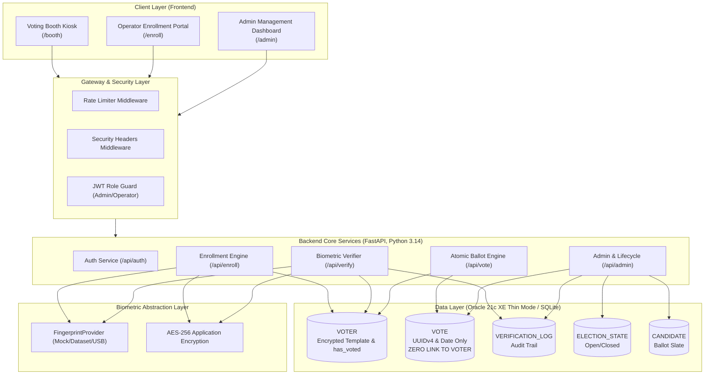

# SecureVote System Architecture

SecureVote is an end-to-end election integrity platform designed to prevent duplicate voting, credential fraud, and ballot stuffing while cryptographically guaranteeing voter privacy through zero-link anonymous ballot storage.

---

## High-Level Architecture Diagram



---

## Core Data Flows

### 1. Citizen Enrollment Flow (`POST /api/enroll`)
1. **Pre-condition**: Election must not be in `open` polling state.
2. Operator submits citizen's legal name, ID document type, ID number, and biometric fingerprint sample.
3. **ID Sanitization & Hashing**:
   - `id_last4` is extracted for operator visual verification.
   - Salted SHA-256 hash (`id_hash = SHA256(salt + id_number)`) is generated. The plaintext ID is immediately discarded.
4. **Duplicate ID Check**: System queries `VOTER WHERE id_hash = :hash`. Rejects with `409 Conflict` if already registered.
5. **Duplicate Person Biometric Check (1:N)**:
   - System extracts minutiae from sample.
   - Compares against all currently registered decrypted templates using `provider.match()`.
   - If similarity score exceeds threshold, rejects with `409 Conflict` (prevents one person registering under multiple identities).
6. **Application Encryption**: Minutiae template is encrypted with symmetric AES (`biometric_cipher`).
7. **Database Persistence**: Inserted into `VOTER` with `has_voted = 'N'`, a fresh `UUIDv4`, and masked `id_last4`.

---

### 2. Biometric Verification Flow (`POST /api/verify`)
1. **Pre-condition**: Polling must be `open`.
2. Voter UUID is queried along with live biometric scan from the booth terminal.
3. **Lockout Guard**: System checks `VERIFICATION_LOCKOUT`. If $\ge 3$ consecutive failed attempts have occurred within the lockout window, verification is denied immediately.
4. **Duplicate Ballot Check**: If `has_voted == 'Y'`, verification is immediately rejected with `DUPLICATE_ATTEMPT`.
5. **1:1 Biometric Comparison**:
   - Voter's encrypted template is loaded from `VOTER` and decrypted in application memory.
   - Live scan minutiae is extracted and compared against the stored template.
6. **Audit Trail**: Every attempt—regardless of outcome—is recorded to `VERIFICATION_LOG` with timestamp, result code, reason, and workstation identifier.
7. **Single-Use Vote Token**:
   - On matching success, a signed JWT vote token is issued.
   - **Lifespan**: Exactly 2 minutes.
   - **Payload**: Random unique token ID (`jti`) and voter UUID.

---

### 3. Atomic Anonymous Ballot Cast Flow (`POST /api/vote`)
1. **Token Validation**:
   - Verifies JWT cryptographic signature and ensures token is unexpired.
   - Confirms token `jti` is not in `CONSUMED_VOTE_TOKENS` table.
2. **Single Atomic Database Transaction**:
   ```sql
   UPDATE VOTER
   SET has_voted = 'Y', voted_at = CURRENT_TIMESTAMP
   WHERE voter_id = :voter_id AND has_voted = 'N';
   ```
   - Application strictly verifies `cursor.rowcount == 1`.
   - If `rowcount == 0`, a concurrent race condition occurred. The transaction **immediately executes `ROLLBACK`** and returns `409 Conflict`.
   - In the exact same transaction, the ballot is inserted:
     ```sql
     INSERT INTO VOTE (vote_id, candidate_id, vote_date)
     VALUES (:random_uuid, :candidate_id, :calendar_date_only);
     ```
   - The token `jti` is inserted into `CONSUMED_VOTE_TOKENS`.
   - `COMMIT` transaction.
3. **Anonymity Guarantee**:
   - `VOTE` contains **zero** foreign key to `VOTER`.
   - `VOTE` contains **zero** voter identifiers.
   - `vote_date` contains **only calendar date** (`YYYY-MM-DD`), preventing side-channel timing analysis.

---

## Production Deployment & HTTPS Guidelines

1. **Reverse Proxy & TLS Termination**:
   - Deploy backend behind Nginx, Caddy, or an AWS Application Load Balancer with TLS 1.3 only.
   - Enforce HSTS (`Strict-Transport-Security: max-age=31536000; includeSubDomains; preload`).
2. **Kiosk Network Isolation**:
   - Voting booth kiosks should operate on an isolated VLAN with no public internet ingress.
   - Kiosk terminals connect strictly via internal mutual TLS (mTLS) or pinned private certificate authority to the backend API.
3. **Key Management**:
   - `BIOMETRIC_ENCRYPTION_KEY` and `SECRET_KEY` should be provisioned via HashiCorp Vault or AWS KMS / Azure Key Vault.
