# SecureVote Database Entity-Relationship Diagram

This document illustrates the Oracle 21c XE database schema for **SecureVote**, highlighting the deliberate, non-negotiable absence of any relationship between the voter registry and cast ballots.

---

## Entity-Relationship Diagram

```mermaid
erDiagram
    VOTER {
        VARCHAR2(36) voter_id PK "UUIDv4 Primary Key"
        VARCHAR2(100) name "Full legal name"
        VARCHAR2(50) id_type "ID document category"
        CHAR(4) id_last4 "Last 4 digits for operator check"
        VARCHAR2(64) id_hash UK "Salted SHA-256 hash of full ID"
        BLOB fingerprint_template "AES-256 encrypted minutiae"
        CHAR(1) has_voted "Check in ('Y', 'N')"
        TIMESTAMP enrolled_at "Enrollment timestamp"
        TIMESTAMP voted_at "Eligibility flip timestamp"
    }

    CANDIDATE {
        VARCHAR2(36) candidate_id PK "UUIDv4 Primary Key"
        VARCHAR2(100) name "Candidate legal name"
        VARCHAR2(100) party "Political party or coalition"
        VARCHAR2(500) description "Candidate platform"
        TIMESTAMP created_at "Registration timestamp"
    }

    VOTE {
        VARCHAR2(36) vote_id PK "Random UUIDv4 (Never sequential)"
        VARCHAR2(36) candidate_id FK "References CANDIDATE(candidate_id)"
        DATE vote_date "Calendar date only (No hours/mins/secs)"
    }

    VERIFICATION_LOG {
        VARCHAR2(36) log_id PK "UUIDv4 Primary Key"
        VARCHAR2(36) voter_id "Nullable UUID of voter"
        TIMESTAMP attempted_at "Verification attempt timestamp"
        VARCHAR2(50) result "SUCCESS, DUPLICATE_ATTEMPT, etc."
        VARCHAR2(255) reason "Explanatory audit message"
        VARCHAR2(50) workstation_id "Terminal identifier"
    }

    ADMIN_USER {
        VARCHAR2(36) admin_id PK "UUIDv4 Primary Key"
        VARCHAR2(50) username UK "Unique system handle"
        VARCHAR2(255) password_hash "PBKDF2-HMAC-SHA256 hash"
        VARCHAR2(20) role "admin or booth-operator"
        TIMESTAMP created_at "Account creation timestamp"
    }

    ELECTION_STATE {
        VARCHAR2(50) state_key PK "e.g. polling_status"
        VARCHAR2(50) state_value "open or closed"
        TIMESTAMP updated_at "State transition timestamp"
    }

    CONSUMED_VOTE_TOKENS {
        VARCHAR2(36) token_jti PK "Single-use JWT JTI"
        TIMESTAMP consumed_at "Consumption timestamp"
    }

    VERIFICATION_LOCKOUT {
        VARCHAR2(36) voter_id PK "Voter UUID"
        INTEGER failed_count "Consecutive failed attempts"
        TIMESTAMP locked_until "Lockout expiration timestamp"
        TIMESTAMP last_failed_at "Last failed timestamp"
    }

    CANDIDATE ||--o{ VOTE : "receives anonymous ballots"
```

---

## Architectural Separation Highlights

> [!IMPORTANT]
> **Complete Decoupling of VOTER and VOTE (AGENTS.md Rule 1)**:
> Note that in the diagram above, there is **NO line connecting `VOTER` and `VOTE`**.
>
> 1. **No Foreign Keys**: `VOTE` has zero foreign key constraints referencing `VOTER`.
> 2. **No Voter References**: No `voter_id`, national ID, biometric ID, IP address, or workstation identifier exists in the `VOTE` table.
> 3. **Coarse Date Precision**: `VOTE.vote_date` is strictly an Oracle `DATE` truncated to `YYYY-MM-DD`. Hour, minute, second, and fractional second values are strictly prohibited to prevent correlation attacks matching timestamps between `VOTER.voted_at` and `VOTE`.
> 4. **Random UUIDs**: Every `vote_id` is an independently generated `UUIDv4`, preventing ballot submission order inference.

---

## Table Schemas & Constraints Reference

### 1. `VOTER`
* **Primary Key**: `voter_id`
* **Unique Constraints**: `id_hash` (prevents double enrollment under same ID)
* **Check Constraints**: `has_voted IN ('Y', 'N')`
* **Indexes**: `idx_voter_name (name)`, `idx_voter_has_voted (has_voted)`

### 2. `CANDIDATE`
* **Primary Key**: `candidate_id`

### 3. `VOTE`
* **Primary Key**: `vote_id`
* **Foreign Keys**: `candidate_id REFERENCES CANDIDATE(candidate_id)`
* **Indexes**: `idx_vote_candidate (candidate_id)`, `idx_vote_date (vote_date)`

### 4. `VERIFICATION_LOG`
* **Primary Key**: `log_id`
* **Indexes**: `idx_verif_attempted (attempted_at)`, `idx_verif_result (result)`, `idx_verif_voter (voter_id)`
