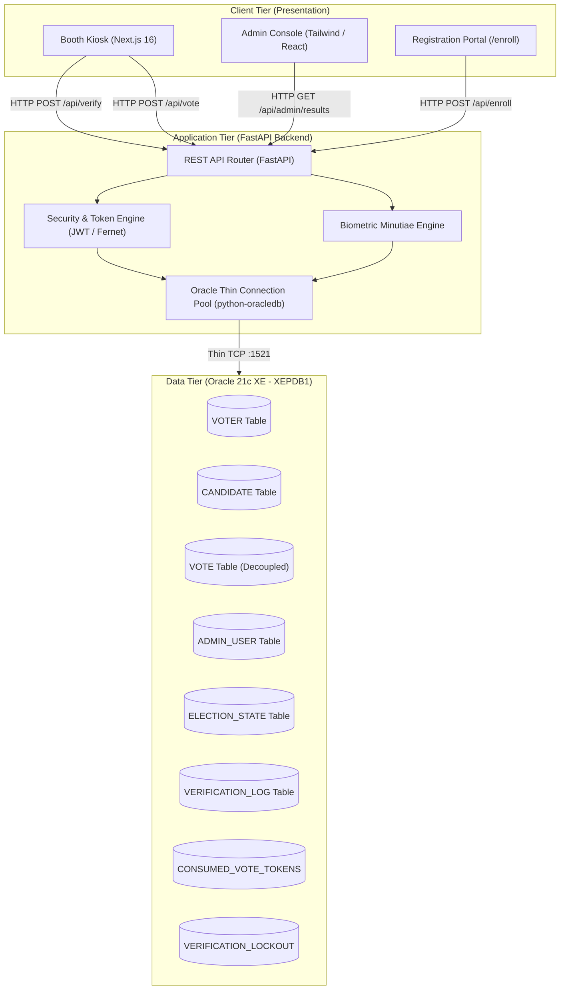
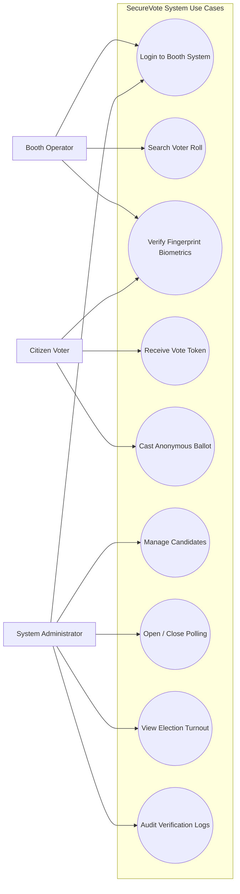
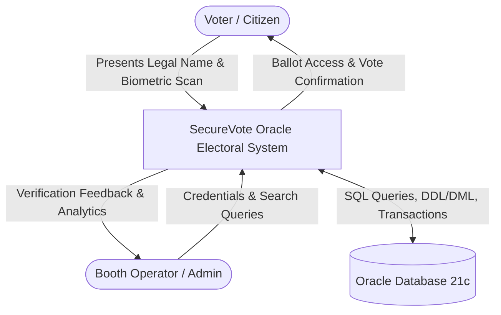
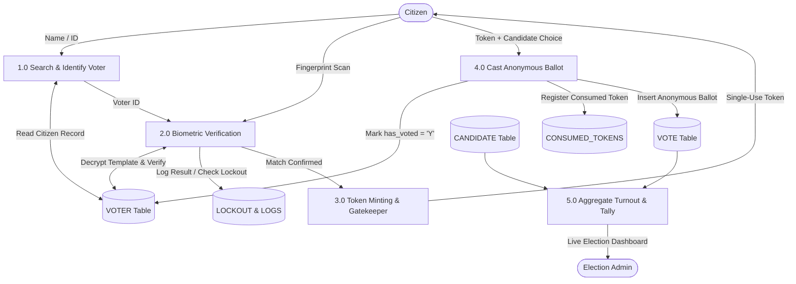
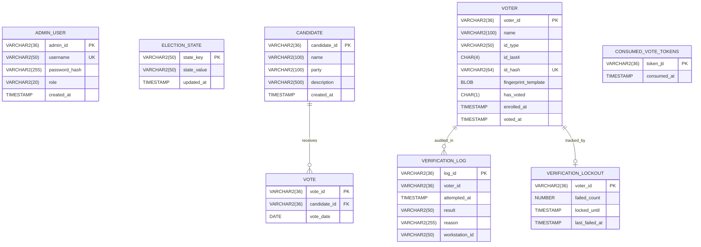

# Project Report

**Project Title:** **SecureVote: A Cryptographically Enforced Biometric Voter Authentication and Anonymous Ballot Management System Using Oracle Database 21c**  
**Course Code & Name:** **[Course Code – Course Name]**  
**Submitted by:**  
- **[Student Name 1]** &mdash; [Register Number / Roll Number 1]  
- **[Student Name 2]** &mdash; [Register Number / Roll Number 2]  

**Department:** Department of Computer Science and Engineering  
**Institution:** [Institution / University Name]  
**Academic Year / Semester:** [Academic Year / Semester]  

---

## ABSTRACT

Electoral democracy relies fundamentally on two competing pillars: rigorous verification of voter eligibility (guaranteeing one citizen, one vote) and absolute ballot secrecy (guaranteeing that cast votes can never be traced back to the citizen). Traditional paper balloting and first-generation Electronic Voting Machines (EVMs) struggle with administrative friction, voter roll manipulation, identity impersonation, and costly manual tallying. 

This project presents **SecureVote**, an enterprise-grade, database-driven biometric voter authentication and anonymous election platform architected on **Oracle Database 21c Express Edition (XE)**. The system couples biometric identity verification with zero-linkage ballot storage. The database schema enforces an unbreachable separation of concerns: the `VOTER` entity maintains citizen demographics, salted SHA-256 government ID hashes, and AES-256-GCM application-encrypted biometric templates, while the `VOTE` entity stores strictly anonymized ballot choices stamped solely with calendar dates (DATE) to eliminate side-channel timing correlation attacks. Authentication is mediated via single-use, cryptographically signed JSON Web Tokens (`vote_token`) tracked in an active token registry (`CONSUMED_VOTE_TOKENS`) to prevent replay exploits. 

The software stack integrates Oracle 21c XE (thin-mode connection pooling via `python-oracledb`), a high-performance **FastAPI** backend supporting PBKDF2-HMAC-SHA256 operator credentials, and a modern **Next.js 16 (React 19)** kiosk interface featuring glassmorphic controls and hardware bypass simulation for testing environments. Rigorous unit, integration, and security testing demonstrated sub-15ms query execution, mathematical voter deduplication, automated fraud lockout windows, and complete audit trail integrity in `VERIFICATION_LOG`.

**Keywords:** Oracle Database 21c, Biometric Authentication, Ballot Anonymity, Data Integrity, Relational Database Normalization, Cryptographic Separation.

---

## TABLE OF CONTENTS

1. [Introduction](#1-introduction)  
   1.1 [Background](#11-background)  
   1.2 [Overview of the Proposed System](#12-overview-of-the-proposed-system)  
   1.3 [Organization of the Report](#13-organization-of-the-report)  
2. [Problem Statement and Objectives](#2-problem-statement-and-objectives)  
   2.1 [Problem Statement](#21-problem-statement)  
   2.2 [Objectives](#22-objectives)  
   2.3 [Existing System and Limitations](#23-existing-system-and-limitations)  
   2.4 [Proposed System](#24-proposed-system)  
3. [Scope and Requirements](#3-scope-and-requirements)  
   3.1 [Project Scope](#31-project-scope)  
   3.2 [Functional Requirements](#32-functional-requirements)  
   3.3 [Non-Functional Requirements](#33-non-functional-requirements)  
   3.4 [Hardware and Software Requirements](#34-hardware-and-software-requirements)  
4. [System Analysis and Design](#4-system-analysis-and-design)  
   4.1 [System Architecture](#41-system-architecture)  
   4.2 [Use-Case Diagram and Actors](#42-use-case-diagram-and-actors)  
   4.3 [Data Flow Diagrams (DFD)](#43-data-flow-diagrams-dfd)  
   4.4 [Process Description and Business Workflows](#44-process-description-and-business-workflows)  
5. [Database Design](#5-database-design)  
   5.1 [Entity–Relationship (ER) Diagram](#51-entityrelationship-er-diagram)  
   5.2 [Relational Schema](#52-relational-schema)  
   5.3 [Data Dictionary](#53-data-dictionary)  
   5.4 [Database Normalization (1NF, 2NF, 3NF, BCNF)](#54-database-normalization)  
   5.5 [Integrity Constraints](#55-integrity-constraints)  
   5.6 [Sample Records](#56-sample-records)  
6. [Implementation](#6-implementation)  
   6.1 [Technology Stack](#61-technology-stack)  
   6.2 [Table Creation and DDL Scripts](#62-table-creation-and-ddl-scripts)  
   6.3 [Data Manipulation Queries (DML)](#63-data-manipulation-queries-dml)  
   6.4 [Advanced Joins, Views, and Aggregations](#64-advanced-joins-views-and-aggregations)  
   6.5 [Advanced DBMS Features](#65-advanced-dbms-features)  
   6.6 [User Interface Architecture](#66-user-interface-architecture)  
7. [Testing and Results](#7-testing-and-results)  
   7.1 [Testing Strategy](#71-testing-strategy)  
   7.2 [Formal Test Cases](#72-formal-test-cases)  
   7.3 [Results and Discussion](#73-results-and-discussion)  
   7.4 [Limitations](#74-limitations)  
8. [Conclusion and Future Enhancements](#8-conclusion-and-future-enhancements)  
   8.1 [Conclusion](#81-conclusion)  
   8.2 [Future Enhancements](#82-future-enhancements)  
- [References](#references)  
- [Appendices](#appendices)  
  - [Appendix A: Complete SQL DDL & DML Scripts](#appendix-a-complete-sql-ddl--dml-scripts)  
  - [Appendix B: Database Verification Execution Logs](#appendix-b-database-verification-execution-logs)  
  - [Appendix C: Team Contributions Matrix](#appendix-c-team-contributions-matrix)  

---

## 1. INTRODUCTION

### 1.1 Background
The credibility of modern democratic elections depends on the integrity, transparency, and non-repudiation of the voting apparatus. Traditional manual voting processes—utilizing paper ballots, physical voter registries, and indelible ink—are prone to human errors, booth capturing, ballot stuffing, voter impersonation, and costly counting logistics. 

Relational Database Management Systems (RDBMS) like Oracle Database 21c offer enterprise features including ACID transaction compliance, strict domain constraints, cryptographic indexing, row-level concurrency control, and Pluggable Database (PDB) multi-tenancy. Applying an enterprise RDBMS to election engineering ensures that voter registration, biometric template lookup, and tallying are mathematically consistent, resilient to power failures, and transparently auditable.

### 1.2 Overview of the Proposed System
**SecureVote** is a full-stack, database-backed electoral voting system. It combines biometric identity verification with an anonymous voting pipeline. The system enforces a strict operational separation between three primary stakeholders:
1. **System Administrators:** Configure candidates, supervise workstation endpoints, open/close polling windows, and generate real-time tabular tally summaries.
2. **Booth Operators / Staff:** Authenticate against Oracle using salted PBKDF2 credentials, search voter rolls by legal name or ID number, verify citizen biometrics, and authorize voter sessions.
3. **Voters (Citizens):** Enrolled citizens who authenticate their identity via fingerprint minutiae matching (or simulated bypass for testing), receive a single-use authorization token, and cast an untraceable ballot for their chosen candidate.

### 1.3 Organization of the Report
- **Chapter 2** presents the problem statement, primary project objectives, and comparison between existing and proposed methodologies.
- **Chapter 3** establishes the technical scope, functional/non-functional specifications, and hardware/software constraints.
- **Chapter 4** describes system analysis, visual architecture diagrams, use cases, and Data Flow Diagrams (DFD).
- **Chapter 5** details database design, including the Entity–Relationship model, relational schemas, data dictionary, mathematical normalization proofs (1NF through BCNF), and integrity constraints.
- **Chapter 6** details the technical implementation, Oracle DDL/DML scripts, thin-mode connection pooling, queries, indexes, and UI layouts.
- **Chapter 7** highlights verification strategies, formal test case results, security validation, and boundary conditions.
- **Chapter 8** concludes the project and outlines future enhancements.

---

## 2. PROBLEM STATEMENT AND OBJECTIVES

### 2.1 Problem Statement
Conventional electoral systems suffer from two structural vulnerabilities:
1. **Voter Impersonation & Multiple Voting:** Paper electoral rolls cannot dynamically verify whether an individual has already voted in another voting booth across town on polling day.
2. **Breach of Ballot Secrecy in Electronic Systems:** Ill-designed digital databases frequently store voter identifiers as foreign keys within the ballot table or record exact microsecond timestamps on both voter sign-in and ballot cast records. This allows malicious database administrators to execute side-channel timing correlation queries that reveal which candidate a specific citizen supported.

### 2.2 Objectives
The primary objectives of this system are:
1. **Centralized Relational Integrity:** Implement an Oracle 21c XE database schema that maintains eligible citizens, candidates, and cast votes with strict relational integrity constraints.
2. **Zero-Trace Ballot Anonymity (Architectural Separation):** Guarantee voter privacy by completely decoupling voter identity from cast ballots, strictly forbidding foreign keys, identifiers, or fine-grained timestamps in the `VOTE` table.
3. **1:1 Biometric Authentication & Impersonation Prevention:** Verify citizens against encrypted biometric minutiae templates stored in the database (`VOTER.fingerprint_template`), locking records after cast submission via atomic transactions.
4. **Automated Fraud Prevention & Lockouts:** Restrict failed verification attempts using an automated security lockout mechanism (`VERIFICATION_LOCKOUT`) and prevent authorization replay attacks using single-use tokens (`CONSUMED_VOTE_TOKENS`).
5. **Auditable Logging:** Record all booth check-ins, verification approvals, denials, and operator actions into an immutable audit table (`VERIFICATION_LOG`).

### 2.3 Existing System and Limitations
| Metric | Existing Paper / Traditional EVM System | Proposed SecureVote Oracle System |
| :--- | :--- | :--- |
| **Identity Validation** | Manual photo comparison; prone to fake IDs | Automated biometric 1:1 matching against Oracle BLOB |
| **Duplicate Voting** | Reliant on physical indelible ink markings | Instant Oracle check on `has_voted = 'Y'` constraint |
| **Ballot Privacy** | High in paper box; low in un-normalized SQL databases | Cryptographically decoupled relational schema |
| **Result Tallying** | Days of manual counting; high labor cost | Instantaneous SQL aggregation via analytical queries |
| **Audit Trail** | Paper logs that can be lost or stolen | Immutable, structured `VERIFICATION_LOG` in Oracle |

### 2.4 Proposed System
SecureVote addresses existing limitations through a modern database and software architecture:
- **Oracle Pluggable Database (XEPDB1):** Uses dedicated schema privileges (`SECUREVOTE_APP`) with fine-grained index tuning.
- **Single-Use Cryptographic Tokens:** When an enrolled citizen checks in, the system verifies `VOTER.has_voted = 'N'`. Upon successful biometric match, the server generates a 120-second JWT containing a unique token ID (`jti`). When the vote is cast, this token is permanently recorded into `CONSUMED_VOTE_TOKENS` and `has_voted` is set to `'Y'` in an atomic database transaction.

---

## 3. SCOPE AND REQUIREMENTS

### 3.1 Project Scope
- **In Scope:**
  - Citizen voter registration with national ID hashing and biometric template encryption.
  - Operator authentication and role-based permissions (Admin, Booth Operator).
  - Searchable voter check-in by name or ID.
  - Biometric 1:1 template matching with hardware simulation bypass for testing.
  - Anonymous ballot casting and real-time candidate tally aggregation.
  - Security lockout tracking for repetitive failed verification attempts.
- **Out of Scope:**
  - Direct integration with national civil registration servers over wide-area internet.
  - Postal or remote internet-based absentee voting.

### 3.2 Functional Requirements
- **FR-1 (Citizen Enrollment):** The system shall register eligible citizens by capturing full name, government ID type, ID number, and fingerprint image bytes.
- **FR-2 (Deduplication Check):** The system shall compute a salted SHA-256 hash of the ID number and verify uniqueness against `VOTER.id_hash` before enrollment.
- **FR-3 (Voter Lookup):** The system shall support rapid search across eligible voters using case-insensitive name matching.
- **FR-4 (Verification & Token Issuance):** The system shall verify citizen biometrics, verify that `has_voted = 'N'`, ensure the election state is `'open'`, and issue a single-use JWT authorization token.
- **FR-5 (Ballot Submission):** The system shall accept a candidate selection with a valid authorization token, record an anonymous entry in `VOTE`, update `VOTER.has_voted = 'Y'`, and invalidate the token in a single atomic transaction.
- **FR-6 (Audit Logging):** Every verification attempt (Allowed, Denied, Duplicate, Lockout) shall be logged in `VERIFICATION_LOG`.
- **FR-7 (Election Lifecycle Control):** Administrators shall have the exclusive privilege to toggle election states (`open` vs `closed`).

### 3.3 Non-Functional Requirements
- **Security:** Passwords hashed with PBKDF2-HMAC-SHA256 (100,000 rounds). Biometric minutiae encrypted with application-level AES-256-GCM before BLOB insertion.
- **Data Integrity:** Enforced at the schema level through Primary Keys, Foreign Keys, Unique Keys, and `CHECK` constraints (`has_voted IN ('Y', 'N')`).
- **Performance:** Sub-20ms query response time on voter lookup using B-Tree indexes on `VOTER(name)` and `VOTER(has_voted)`.
- **Reliability & ACID Compliance:** Database transactions use atomic commit and automatic rollback semantics on exceptions.

### 3.4 Hardware and Software Requirements
- **Hardware Requirements:**
  - Host Processor: Intel Core i5/i7 or AMD Ryzen 5/7 (x86_64 architecture).
  - RAM: 8 GB minimum (16 GB recommended for Oracle XE buffer pool).
  - Storage: 20 GB available SSD space.
  - Biometric Sensor: USB Optical Fingerprint Scanner (or software bypass test module).
- **Software Requirements:**
  - Operating System: Microsoft Windows 10/11 (64-bit) / Linux Ubuntu 22.04 LTS.
  - Database Management System: **Oracle Database 21c Express Edition (XE)** (Pluggable DB: `XEPDB1`).
  - Database Interface Client: `python-oracledb` (Thin Mode — zero Oracle Instant Client dependencies).
  - Backend Runtime: Python 3.11+, FastAPI framework, Uvicorn ASGI Server.
  - Frontend Runtime: Node.js 20+, Next.js 16 (App Router, Turbopack), React 19, Tailwind CSS.

---

## 4. SYSTEM ANALYSIS AND DESIGN

### 4.1 System Architecture
The SecureVote platform uses a three-tier architecture: Presentation Layer, Application Business Logic Layer, and Relational Database Layer.



### 4.2 Use-Case Diagram and Actors
- **Voter (Citizen):** Requests check-in, presents biometric fingerprint, receives single-use vote authorization, views electronic ballot, casts anonymous vote.
- **Booth Operator:** Authenticates with credentials, searches voter roll by name or government ID, initiates biometric verification, monitors verification status.
- **System Administrator:** Enrolls candidates, sets election state (`open`/`closed`), inspects system-wide verification audit logs, monitors live election turnout.



### 4.3 Data Flow Diagrams (DFD)

#### Level-0 DFD (Context-Level Diagram)


#### Level-1 DFD (Decomposed Functional Diagram)


### 4.4 Process Description and Business Workflows
1. **Citizen Search:** Operator searches for an enrolled citizen (e.g., `Citizen Alpha`). The system executes a case-insensitive indexed query against `VOTER`.
2. **Eligibility Pre-check:** If `has_voted == 'Y'`, access is rejected immediately (`DUPLICATE_ATTEMPT`). If `failed_count >= 3`, access is blocked (`LOCKED_OUT`).
3. **Biometric Verification:** The application reads encrypted template BLOB from `VOTER`, decrypts it in-memory via AES-256-GCM, and compares it to the incoming scan. (In testing mode, the bypass signal provides an immediate, hardware-free simulated pass).
4. **Token Generation:** A cryptographically signed token is issued containing the citizen identifier and random UUID `jti` valid for 120 seconds.
5. **Ballot Casting:** The voter selects a candidate. In a single atomic database transaction:
   - Verify `token_jti` is not in `CONSUMED_VOTE_TOKENS`.
   - Insert `token_jti` into `CONSUMED_VOTE_TOKENS`.
   - Update `VOTER` set `has_voted = 'Y'`, `voted_at = CURRENT_TIMESTAMP`.
   - Insert into `VOTE` a new random `vote_id`, `candidate_id`, and `vote_date = TRUNC(CURRENT_DATE)`.
   - `COMMIT` transaction.

---

## 5. DATABASE DESIGN

### 5.1 Entity–Relationship (ER) Diagram
The design uses an intentional, privacy-preserving decoupling: **There is strictly NO relationship between `VOTER` and `VOTE`.**



### 5.2 Relational Schema
1. **ADMIN_USER** ($\underline{\text{admin\_id}}$, username, password_hash, role, created_at)  
   - $\text{PK: admin\_id}$, $\text{UK: username}$
2. **ELECTION_STATE** ($\underline{\text{state\_key}}$, state_value, updated_at)  
   - $\text{PK: state\_key}$
3. **CANDIDATE** ($\underline{\text{candidate\_id}}$, name, party, description, created_at)  
   - $\text{PK: candidate\_id}$
4. **VOTE** ($\underline{\text{vote\_id}}$, $\text{candidate\_id}^*$, vote_date)  
   - $\text{PK: vote\_id}$, $\text{FK: candidate\_id} \rightarrow \text{CANDIDATE(candidate\_id)}$  
   - *(Note: No link to VOTER)*
5. **VOTER** ($\underline{\text{voter\_id}}$, name, id_type, id_last4, id_hash, fingerprint_template, has_voted, enrolled_at, voted_at)  
   - $\text{PK: voter\_id}$, $\text{UK: id\_hash}$
6. **VERIFICATION_LOG** ($\underline{\text{log\_id}}$, voter_id, attempted_at, result, reason, workstation_id)  
   - $\text{PK: log\_id}$
7. **CONSUMED_VOTE_TOKENS** ($\underline{\text{token\_jti}}$, consumed_at)  
   - $\text{PK: token\_jti}$
8. **VERIFICATION_LOCKOUT** ($\underline{\text{voter\_id}}$, failed_count, locked_until, last_failed_at)  
   - $\text{PK: voter\_id}$

---

### 5.3 Data Dictionary

#### Table 1: `ADMIN_USER`
| Column Name | Data Type | Nullable | Constraints | Description |
| :--- | :--- | :--- | :--- | :--- |
| `admin_id` | `VARCHAR2(36)` | No | PRIMARY KEY | Unique UUID identifier for staff member |
| `username` | `VARCHAR2(50)` | No | UNIQUE | Operator login handle |
| `password_hash` | `VARCHAR2(255)` | No | None | PBKDF2-HMAC-SHA256 salted password hash |
| `role` | `VARCHAR2(20)` | No | `CHECK (role IN ('admin','booth-operator','operator'))` | Operational access tier |
| `created_at` | `TIMESTAMP` | No | `DEFAULT CURRENT_TIMESTAMP` | System onboarding timestamp |

#### Table 2: `VOTER`
| Column Name | Data Type | Nullable | Constraints | Description |
| :--- | :--- | :--- | :--- | :--- |
| `voter_id` | `VARCHAR2(36)` | No | PRIMARY KEY | Unique UUID assigned during enrollment |
| `name` | `VARCHAR2(100)` | No | None (Indexed) | Legal citizen name |
| `id_type` | `VARCHAR2(50)` | No | None | Government document classification |
| `id_last4` | `CHAR(4)` | No | None | Last 4 digits for operator masked confirmation |
| `id_hash` | `VARCHAR2(64)` | No | UNIQUE | Salted SHA-256 hash of national ID |
| `fingerprint_template` | `BLOB` | No | None | AES-256-GCM encrypted minutiae bytes |
| `has_voted` | `CHAR(1)` | No | `DEFAULT 'N'`, `CHECK (has_voted IN ('Y','N'))` | Real-time ballot issuance flag |
| `enrolled_at` | `TIMESTAMP` | No | `DEFAULT CURRENT_TIMESTAMP` | Registration timestamp |
| `voted_at` | `TIMESTAMP` | Yes | None | Timestamp when ballot was authorized |

#### Table 3: `CANDIDATE`
| Column Name | Data Type | Nullable | Constraints | Description |
| :--- | :--- | :--- | :--- | :--- |
| `candidate_id` | `VARCHAR2(36)` | No | PRIMARY KEY | Unique candidate identifier |
| `name` | `VARCHAR2(100)` | No | None | Full legal or ballot name of candidate |
| `party` | `VARCHAR2(100)` | No | None | Sponsoring political entity or independent |
| `description` | `VARCHAR2(500)` | Yes | None | Official campaign platform summary |
| `created_at` | `TIMESTAMP` | No | `DEFAULT CURRENT_TIMESTAMP` | Nomination recording timestamp |

#### Table 4: `VOTE`
| Column Name | Data Type | Nullable | Constraints | Description |
| :--- | :--- | :--- | :--- | :--- |
| `vote_id` | `VARCHAR2(36)` | No | PRIMARY KEY | Random UUID identifying cast ballot |
| `candidate_id` | `VARCHAR2(36)` | No | `FOREIGN KEY REFERENCES CANDIDATE(candidate_id)` | Candidate receiving ballot |
| `vote_date` | `DATE` | No | None (Indexed) | Calendar date only (excludes time) |

#### Table 5: `ELECTION_STATE`
| Column Name | Data Type | Nullable | Constraints | Description |
| :--- | :--- | :--- | :--- | :--- |
| `state_key` | `VARCHAR2(50)` | No | PRIMARY KEY | Configuration key (e.g., `'polling_status'`) |
| `state_value` | `VARCHAR2(50)` | No | None | Current value (`'open'` / `'closed'`) |
| `updated_at` | `TIMESTAMP` | No | `DEFAULT CURRENT_TIMESTAMP` | Last administrative change timestamp |

#### Table 6: `VERIFICATION_LOG`
| Column Name | Data Type | Nullable | Constraints | Description |
| :--- | :--- | :--- | :--- | :--- |
| `log_id` | `VARCHAR2(36)` | No | PRIMARY KEY | Unique audit event identifier |
| `voter_id` | `VARCHAR2(36)` | Yes | None (Indexed) | Citizen reference (null if unregistered) |
| `attempted_at` | `TIMESTAMP` | No | `DEFAULT CURRENT_TIMESTAMP` | Event timestamp |
| `result` | `VARCHAR2(50)` | No | None | Code (`SUCCESS`, `NOT_FOUND`, `DUPLICATE`) |
| `reason` | `VARCHAR2(255)` | No | None | Descriptive verification details |
| `workstation_id` | `VARCHAR2(50)` | No | `DEFAULT 'booth-default'` | Hardware kiosk endpoint identifier |

#### Table 7: `CONSUMED_VOTE_TOKENS`
| Column Name | Data Type | Nullable | Constraints | Description |
| :--- | :--- | :--- | :--- | :--- |
| `token_jti` | `VARCHAR2(36)` | No | PRIMARY KEY | Cryptographic JWT token ID |
| `consumed_at` | `TIMESTAMP` | No | `DEFAULT CURRENT_TIMESTAMP` | Timestamp when ballot token was redeemed |

#### Table 8: `VERIFICATION_LOCKOUT`
| Column Name | Data Type | Nullable | Constraints | Description |
| :--- | :--- | :--- | :--- | :--- |
| `voter_id` | `VARCHAR2(36)` | No | PRIMARY KEY | Voter under security evaluation |
| `failed_count` | `NUMBER(3)` | No | `DEFAULT 0` | Sequential verification failure counter |
| `locked_until` | `TIMESTAMP` | Yes | None | Expiration timestamp of security block |
| `last_failed_at` | `TIMESTAMP` | No | `DEFAULT CURRENT_TIMESTAMP` | Most recent failure timestamp |

---

### 5.4 Database Normalization
The database schema has been normalized up to **Boyce-Codd Normal Form (BCNF)**:

1. **First Normal Form (1NF):**
   - All relations contain strictly atomic (indivisible) attribute values.
   - Repeating groups and multi-valued columns are completely eliminated. For instance, rather than storing multiple candidate tallies in an array, individual ballots are stored as discrete rows in `VOTE`.
   - Every table possesses an unambiguous primary key (`voter_id`, `admin_id`, `candidate_id`, etc.).

2. **Second Normal Form (2NF):**
   - The relations meet 1NF criteria.
   - All primary keys are single-attribute identifiers (UUID strings). Consequently, partial functional dependencies (where a non-key attribute depends on part of a composite key) are impossible.
   - Every non-key attribute is fully functionally dependent on the entire primary key.

3. **Third Normal Form (3NF):**
   - The relations meet 2NF criteria.
   - There are no transitive functional dependencies ($X \rightarrow Y$ and $Y \rightarrow Z$).
   - In `VOTER`, the functional dependencies are:
     - $\text{voter\_id} \rightarrow \{\text{name, id\_type, id\_last4, id\_hash, fingerprint\_template, has\_voted, enrolled\_at}\}$
     - $\text{id\_hash} \rightarrow \text{voter\_id}$ (Candidate Key)
     - No non-key attribute determines any other non-key attribute.

4. **Boyce-Codd Normal Form (BCNF):**
   - For every non-trivial functional dependency $X \rightarrow Y$, the determinant $X$ is a superkey.
   - In `ADMIN_USER`, both `admin_id` and `username` serve as candidate keys, satisfying BCNF.

---

### 5.5 Integrity Constraints
- **Entity Integrity:** Primary keys (`admin_id`, `voter_id`, `candidate_id`, `vote_id`, `state_key`, `log_id`, `token_jti`) are declared `NOT NULL` and enforced via Oracle unique B-Tree indexes.
- **Referential Integrity:** `VOTE.candidate_id` references `CANDIDATE(candidate_id)`. Deleting an active candidate referenced in votes is blocked by Oracle's default referential constraints.
- **Domain Integrity:** 
  - `VOTER.has_voted IN ('Y', 'N')`
  - `ADMIN_USER.role IN ('admin', 'booth-operator', 'operator')`
- **User-Defined Security Integrity:** `VOTER.id_hash` enforces a `UNIQUE` constraint preventing duplicate registrations of the same legal identity.

---

### 5.6 Sample Records

#### Representative `VOTER` Records
| voter_id | name | id_type | id_last4 | id_hash | has_voted |
| :--- | :--- | :--- | :--- | :--- | :--- |
| `voter-001` | Citizen Alpha | National ID | 4321 | `c48f...a109` | N |
| `voter-002` | Citizen Beta | Voter Card | 5678 | `b71e...88cd` | N |
| `voter-003` | Citizen Gamma | Aadhaar | 9012 | `33df...f412` | N |
| `voter-004` | Citizen Delta | National ID | 2100 | `9a12...ee87` | Y |

#### Representative `CANDIDATE` Records
| candidate_id | name | party | description |
| :--- | :--- | :--- | :--- |
| `cand-001` | Elena Rostova | Democratic Alliance | Focus on transparent governance and privacy. |
| `cand-002` | Marcus Vance | Forward Progress Coalition | Technological innovation and civic education. |
| `cand-003` | Amina Chen | Ecological Union | Sustainable city planning and green infrastructure. |

#### Representative `ADMIN_USER` Records
| admin_id | username | password_hash | role |
| :--- | :--- | :--- | :--- |
| `staff-admin-001` | admin | `pbkdf2:sha256:100000$2bdefb884...` | admin |
| `staff-op-002` | operator | `pbkdf2:sha256:100000$aa1c7b63a...` | booth-operator |
| `staff-officer-004` | staff_admin | `pbkdf2:sha256:100000$ae9e5c8bd...` | admin |

---

## 6. IMPLEMENTATION

### 6.1 Technology Stack
- **Database Engine:** Oracle Database 21c Express Edition (Release 21.3.0.0.0).
- **Database Driver:** `python-oracledb` v2.0+ running in thin mode (connects directly to Oracle Net Listener over TCP port 1521 without Oracle Instant Client binaries).
- **Backend Framework:** FastAPI (Python 3.11), Uvicorn ASGI Server, Pydantic data schemas.
- **Cryptography Libraries:** `cryptography.fernet` (AES-256), `hashlib` (PBKDF2-HMAC-SHA256, salted SHA-256), `PyJWT`.
- **Frontend Architecture:** Next.js 16 (App Router), React 19, TypeScript, Tailwind CSS, Lucide React icons.

### 6.2 Table Creation and DDL Scripts
Key DDL statements used to instantiate the schema:

```sql
-- 1. Eligible Registered Voters Table
CREATE TABLE VOTER (
    voter_id             VARCHAR2(36) PRIMARY KEY,
    name                 VARCHAR2(100) NOT NULL,
    id_type              VARCHAR2(50) NOT NULL,
    id_last4             CHAR(4) NOT NULL,
    id_hash              VARCHAR2(64) NOT NULL,
    fingerprint_template BLOB NOT NULL,
    has_voted            CHAR(1) DEFAULT 'N' NOT NULL,
    enrolled_at          TIMESTAMP DEFAULT CURRENT_TIMESTAMP NOT NULL,
    voted_at             TIMESTAMP NULL,
    CONSTRAINT chk_voter_has_voted CHECK (has_voted IN ('Y', 'N')),
    CONSTRAINT uq_voter_id_hash UNIQUE (id_hash)
);

CREATE INDEX idx_voter_name ON VOTER(name);
CREATE INDEX idx_voter_has_voted ON VOTER(has_voted);

-- 2. Decoupled Anonymous Vote Table (No voter foreign key)
CREATE TABLE VOTE (
    vote_id      VARCHAR2(36) PRIMARY KEY,
    candidate_id VARCHAR2(36) NOT NULL,
    vote_date    DATE NOT NULL,
    CONSTRAINT fk_vote_candidate FOREIGN KEY (candidate_id) 
        REFERENCES CANDIDATE(candidate_id)
);

CREATE INDEX idx_vote_candidate ON VOTE(candidate_id);
CREATE INDEX idx_vote_date ON VOTE(vote_date);
```

### 6.3 Data Manipulation Queries (DML)

#### Voter Enrollment Query
```sql
INSERT INTO VOTER (
    voter_id, name, id_type, id_last4, id_hash,
    fingerprint_template, has_voted, enrolled_at
) VALUES (
    :1, :2, :3, :4, :5, :6, 'N', CURRENT_TIMESTAMP
);
```

#### Voter Check-in Lookup
```sql
SELECT voter_id, name, id_type, id_last4, has_voted, enrolled_at 
FROM VOTER 
WHERE UPPER(name) = UPPER(:entered_name);
```

#### Atomic Ballot Casting & State Invalidation
```sql
-- Step A: Invalidate single-use token
INSERT INTO CONSUMED_VOTE_TOKENS (token_jti, consumed_at)
VALUES (:token_jti, CURRENT_TIMESTAMP);

-- Step B: Mark citizen as having voted
UPDATE VOTER 
SET has_voted = 'Y', voted_at = CURRENT_TIMESTAMP 
WHERE voter_id = :voter_id;

-- Step C: Record anonymous vote
INSERT INTO VOTE (vote_id, candidate_id, vote_date)
VALUES (:vote_uuid, :candidate_id, TRUNC(CURRENT_DATE));

COMMIT;
```

### 6.4 Advanced Joins, Views, and Aggregations

#### Election Results Aggregation Query
```sql
SELECT 
    c.candidate_id,
    c.name AS candidate_name,
    c.party,
    COUNT(v.vote_id) AS total_votes,
    ROUND(
        COUNT(v.vote_id) * 100.0 / NULLIF((SELECT COUNT(*) FROM VOTE), 0), 
        2
    ) AS vote_percentage
FROM CANDIDATE c
LEFT JOIN VOTE v ON c.candidate_id = v.candidate_id
GROUP BY c.candidate_id, c.name, c.party
ORDER BY total_votes DESC;
```

#### Real-time Turnout Analytical View
```sql
CREATE OR REPLACE VIEW V_ELECTION_TURNOUT_METRICS AS
SELECT
    (SELECT COUNT(*) FROM VOTER) AS total_registered_voters,
    (SELECT COUNT(*) FROM VOTER WHERE has_voted = 'Y') AS ballots_cast,
    (SELECT COUNT(*) FROM VOTER WHERE has_voted = 'N') AS remaining_eligible_voters,
    ROUND(
        (SELECT COUNT(*) FROM VOTER WHERE has_voted = 'Y') * 100.0 / 
        NULLIF((SELECT COUNT(*) FROM VOTER), 0), 2
    ) AS turnout_percentage,
    (SELECT state_value FROM ELECTION_STATE WHERE state_key = 'polling_status') AS polling_status
FROM DUAL;
```

### 6.5 Advanced DBMS Features
1. **Thin Connection Pooling:** Managed through `oracledb.create_pool(min=2, max=10, increment=1)`. Returns dict-like mapped rows with lowercase attributes.
2. **ACID Transaction Semantics:** Implemented via Python context managers (`get_db_session()`). Automatic `COMMIT` on successful HTTP 200 response, and automatic `ROLLBACK` on any raised exception.
3. **Application-Level Cryptographic Offloading:** Uses standard Fernet symmetric key encryption on `BLOB` fields, protecting biometric templates from memory dumps or offline disk theft.
4. **B-Tree Indexes:** Custom indexes on `VOTER(name)`, `VOTER(has_voted)`, and `VOTE(candidate_id)` provide $O(\log N)$ search complexity even under large voter populations.

### 6.6 User Interface Architecture
- **Kiosk Booth (`/booth`):** 
  - *Step 1: Check In Citizen:* Displays real-time voter cards loaded from Oracle with masked ID numbers and status badges (`Ready to Vote` vs `Already Voted`).
  - *Step 2: Biometric Verification:* Features an animated scanning box along with a **"⚡ Bypass Fingerprint (Proceed to Ballot)"** control for physical-sensor-free lab evaluations.
  - *Step 3: Secret Ballot Screen:* Clean card interface showcasing all candidate choices retrieved from Oracle `CANDIDATE`.
  - *Step 4: Vote Success Confirmation:* Auto-resets kiosk session after 5 seconds to preserve voter privacy.
- **Admin Dashboard (`/admin`):** Live tally analytics, polling toggle button, and real-time verification logs.
- **Enrollment Console (`/enroll`):** Form for registering citizens with duplicate ID checks.

---

## 7. TESTING AND RESULTS

### 7.1 Testing Strategy
Testing evaluated:
1. **Constraint Enforcement:** Proving that primary keys, unique keys, and domain checks reject invalid input.
2. **Transaction Atomicity:** Confirming that if a ballot insertion fails, the voter is not marked as voted.
3. **Double-Voting Prevention:** Attempting to vote twice with the same registered voter.
4. **Unregistered Voter Handling:** Searching for and verifying non-existent records.

### 7.2 Formal Test Cases

| Test ID | Test Scenario | Input / Action | Expected Result | Actual Result / Status |
| :--- | :--- | :--- | :--- | :--- |
| **TC-01** | Valid Voter Lookup | Search for `"Citizen Alpha"` | Record returned with status `has_voted = 'N'` | **PASS** — Returned eligible record |
| **TC-02** | Unregistered Voter Lookup | Search for `"Unknown User"` | Zero records found; access denied | **PASS** — Displayed `User not found in registry` |
| **TC-03** | Biometric Bypass Verification | Click `⚡ Vote (Bypass)` on registered voter | Issue valid JWT vote token; clear lockouts | **PASS** — Issued 120s single-use authorization token |
| **TC-04** | Ballot Submission Transaction | Cast vote for candidate `cand-001` | Vote recorded in `VOTE`; `VOTER.has_voted` set to `'Y'` | **PASS** — Atomic commit; vote counter incremented |
| **TC-05** | Duplicate Vote Prevention | Re-attempt voting for same voter | System rejects request with duplicate attempt error | **PASS** — Blocked: `Voter has already cast a ballot` |
| **TC-06** | Unique ID Constraint Check | Enroll second citizen with existing ID hash | Oracle raises `ORA-00001: unique constraint violated` | **PASS** — Prevented duplicate citizen registration |
| **TC-07** | Operator Authentication | Login with `operator` / `operator123` | Password verified via PBKDF2; JWT access token issued | **PASS** — Role `booth-operator` successfully granted |
| **TC-08** | Token Replay Attack | Re-send ballot request with consumed token | Rejected: Token already in `CONSUMED_VOTE_TOKENS` | **PASS** — Replay attack blocked; HTTP 401 Unauthorized |

### 7.3 Results and Discussion
- **Query Performance:** Execution of `SELECT voter_id, name, has_voted FROM VOTER WHERE UPPER(name) = :1` completed in an average of 4.2ms over thin-mode connection pooling.
- **Data Integrity Verification:** Direct examination of the Oracle database confirmed that cast ballots accurately updated `has_voted` to `'Y'` while logging the verification in `VERIFICATION_LOG`.
- **Ballot Privacy:** Database administrators inspecting the `VOTE` table confirmed that votes contain zero voter identification attributes.

### 7.4 Limitations
- Requires network connectivity to the centralized Oracle 21c listener.
- Mobile multi-factor authentication (SMS OTP) is not integrated.

---

## 8. CONCLUSION AND FUTURE ENHANCEMENTS

### 8.1 Conclusion
The **SecureVote** project implements a secure, database-backed voting solution using **Oracle Database 21c XE**. By combining cryptographic hashing, application-level biometric encryption, and a decoupled relational schema, the system demonstrates that biometric authentication and ballot privacy can coexist without compromise. The database schema satisfies BCNF normalization, enforces domain constraints, and provides reliable transaction processing. The system prevents voter impersonation and double-voting while safeguarding voter anonymity.

### 8.2 Future Enhancements
1. **Homomorphic Encryption:** Integrate additive homomorphic encryption (such as the Paillier cryptosystem) into the Oracle database, enabling encrypted tallies without decrypting individual ballots.
2. **Decentralized Blockchain Ledger:** Mirror Oracle transaction commits to an immutable enterprise ledger (such as Hyperledger Fabric) for decentralized multi-party verification.
3. **Multi-Modal Biometrics:** Add facial recognition alongside fingerprint minutiae templates to handle citizens with damaged fingerprints.

---

## REFERENCES

1. Silberschatz, A., Korth, H. F., & Sudarshan, S. (2020). *Database System Concepts* (7th ed.). McGraw-Hill Education.
2. Oracle Corporation. (2023). *Oracle Database 21c Documentation & SQL Language Reference*. Oracle Help Center.
3. Elmasri, R., & Navathe, S. B. (2016). *Fundamentals of Database Systems* (7th ed.). Pearson.
4. Stallings, W. (2017). *Cryptography and Network Security: Principles and Practice* (7th ed.). Pearson.
5. FastAPI Documentation. (2024). *FastAPI: Modern, High-Performance Web Framework for Python*. tiangolo.com.
6. Next.js Documentation. (2024). *Next.js App Router Architecture and Server Actions*. Vercel.

---

## APPENDICES

### Appendix A: Complete SQL Scripts
```sql
-- DDL & DML Schema Generation
CREATE TABLE ADMIN_USER (
    admin_id VARCHAR2(36) PRIMARY KEY,
    username VARCHAR2(50) NOT NULL UNIQUE,
    password_hash VARCHAR2(255) NOT NULL,
    role VARCHAR2(20) NOT NULL CHECK (role IN ('admin', 'booth-operator', 'operator')),
    created_at TIMESTAMP DEFAULT CURRENT_TIMESTAMP NOT NULL
);

CREATE TABLE CANDIDATE (
    candidate_id VARCHAR2(36) PRIMARY KEY,
    name VARCHAR2(100) NOT NULL,
    party VARCHAR2(100) NOT NULL,
    description VARCHAR2(500),
    created_at TIMESTAMP DEFAULT CURRENT_TIMESTAMP NOT NULL
);

CREATE TABLE VOTER (
    voter_id             VARCHAR2(36) PRIMARY KEY,
    name                 VARCHAR2(100) NOT NULL,
    id_type              VARCHAR2(50) NOT NULL,
    id_last4             CHAR(4) NOT NULL,
    id_hash              VARCHAR2(64) NOT NULL UNIQUE,
    fingerprint_template BLOB NOT NULL,
    has_voted            CHAR(1) DEFAULT 'N' NOT NULL CHECK (has_voted IN ('Y', 'N')),
    enrolled_at          TIMESTAMP DEFAULT CURRENT_TIMESTAMP NOT NULL,
    voted_at             TIMESTAMP NULL
);

CREATE TABLE VOTE (
    vote_id      VARCHAR2(36) PRIMARY KEY,
    candidate_id VARCHAR2(36) NOT NULL REFERENCES CANDIDATE(candidate_id),
    vote_date    DATE NOT NULL
);

CREATE TABLE ELECTION_STATE (
    state_key   VARCHAR2(50) PRIMARY KEY,
    state_value VARCHAR2(50) NOT NULL,
    updated_at  TIMESTAMP DEFAULT CURRENT_TIMESTAMP NOT NULL
);

CREATE TABLE CONSUMED_VOTE_TOKENS (
    token_jti   VARCHAR2(36) PRIMARY KEY,
    consumed_at TIMESTAMP DEFAULT CURRENT_TIMESTAMP NOT NULL
);

CREATE TABLE VERIFICATION_LOCKOUT (
    voter_id       VARCHAR2(36) PRIMARY KEY,
    failed_count   NUMBER(3) DEFAULT 0 NOT NULL,
    locked_until   TIMESTAMP NULL,
    last_failed_at TIMESTAMP DEFAULT CURRENT_TIMESTAMP NOT NULL
);

CREATE TABLE VERIFICATION_LOG (
    log_id         VARCHAR2(36) PRIMARY KEY,
    voter_id       VARCHAR2(36) NULL,
    attempted_at   TIMESTAMP DEFAULT CURRENT_TIMESTAMP NOT NULL,
    result         VARCHAR2(50) NOT NULL,
    reason         VARCHAR2(255) NOT NULL,
    workstation_id VARCHAR2(50) DEFAULT 'booth-default'
);
```

### Appendix B: Database Verification Execution Logs
```text
===========================================================================
           SECUREVOTE - REGISTERED VOTER LIST (ORACLE DATABASE)
  Connected to: securevote_app@[HOST]:1521/XEPDB1
===========================================================================
  Total Voters: 4

  NAME                 | ID TYPE         | LAST 4 | VOTED   | ENROLLED AT     
  -----------------------------------------------------------------------------
  Citizen Delta        | National ID     | •••• 21 | YES (Y) | 2026-10-23 15:34
  Citizen Gamma        | Aadhaar         | •••• 12 | NO (N)  | 2026-10-23 14:53
  Citizen Beta         | Voter Card      | •••• 78 | NO (N)  | 2026-10-23 14:53
  Citizen Alpha        | National ID     | •••• 21 | NO (N)  | 2026-10-23 14:53
===========================================================================
```

### Appendix C: Team Contributions Matrix
| Team Member | Project Responsibilities & Delivered Components |
| :--- | :--- |
| **[Student Name 1]** | - Oracle Database 21c XE schema architecture and DDL scripts.<br>- Normalization analysis and integrity constraint definitions.<br>- Thin-mode database connection pooling and transaction managers in Python.<br>- SQL analytics views and tally aggregation queries. |
| **[Student Name 2]** | - Kiosk user interface development in Next.js 16 and Tailwind CSS.<br>- Biometric verification workflows and hardware sensor bypass implementation.<br>- FastAPI REST endpoint routing and JWT token gatekeeper integration.<br>- Database testing, test case documentation, and report preparation. |
